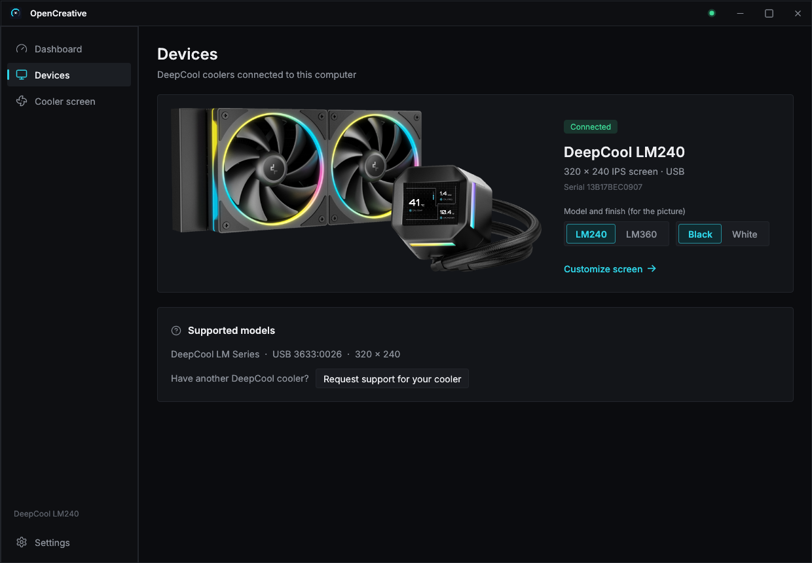
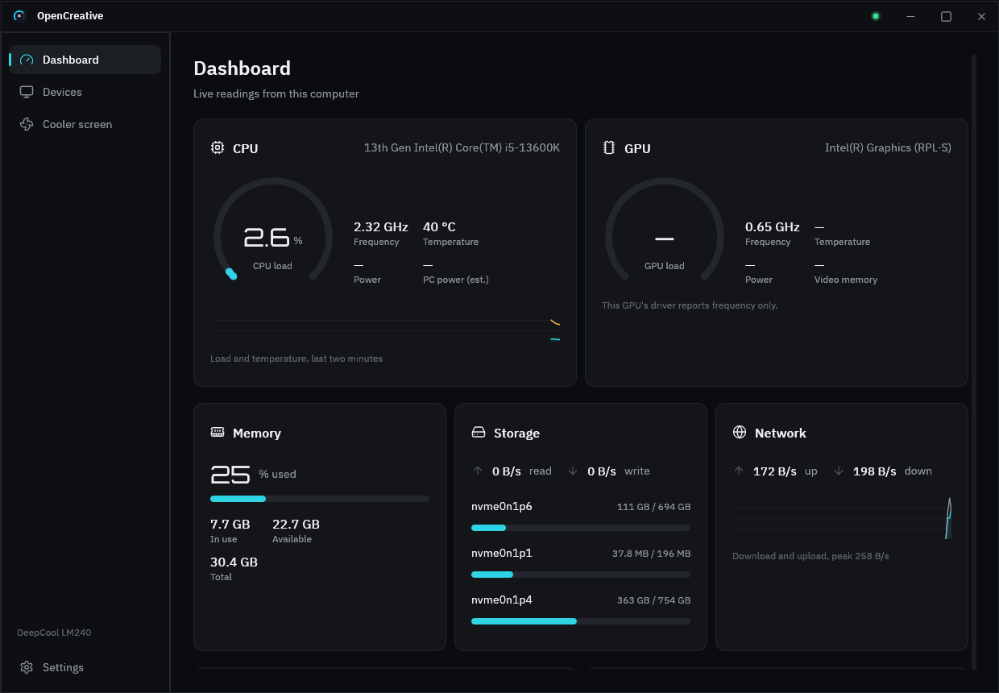
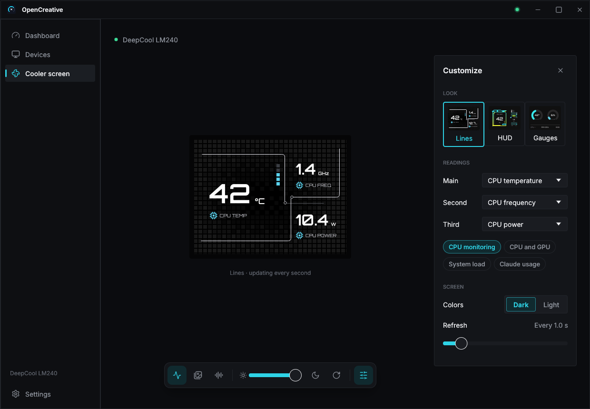
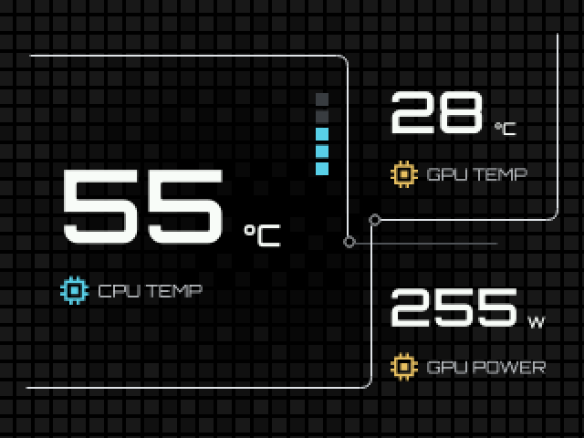
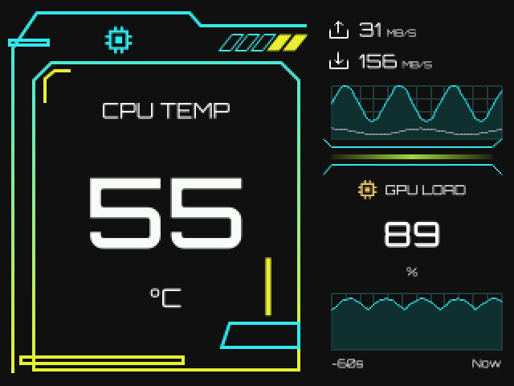
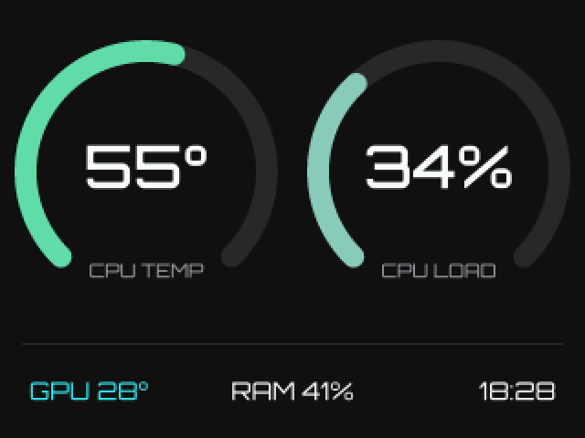

# OpenCreative

[](https://github.com/siam-parvez/opencreative/actions/workflows/ci.yml)
[](https://github.com/siam-parvez/opencreative/releases)

Open-source, cross-platform control for DeepCool LCD coolers, written in Rust.
An alternative to DeepCool's Windows-only DeepCreative app.

> OpenCreative is an independent project. It is not affiliated with or endorsed
> by DeepCool. "DeepCool" and "DeepCreative" are trademarks of their owners.

<p>
  
</p>
<p>
  
  
</p>

### Screen skins

What the cooler shows, rendered at the panel's 320x240 (shown at 2x):

<p>
  
  
  
</p>

**Lines** · **HUD** · **Gauges**. Regenerate with
`cargo run -p opencreative-render --example panels -- out.png [lines|hud|gauges] [landscape|portrait] [claude]`.

## Status

Early. Linux only for now.

| Device | USB ID | Screen | Status |
|---|---|---|---|
| LM240 / LM360 | `3633:0026` | 320x240 | Supported |

Want your cooler supported? [Adding a device](docs/adding-a-device.md) lists
what we need from you: the model, `lsusb` output, a quick test, and ideally a
USB capture of DeepCreative.

## Features

- Panels screen: one large and two small readings of your choice (CPU/GPU
  temperature, load, frequency, power, RAM), like the vendor app's digital
  mode, in a choice of skins: **Lines** (interlocking lines over a tile grid)
  and **HUD** (neon frames with live network and usage charts)
- Power readings: CPU package, GPU (NVIDIA, AMD, Intel integrated) and an
  estimate of the whole PC (`system_power`: the platform counter where the
  CPU has one, else CPU + memory + discrete GPU). On Linux, CPU power needs
  **Settings → Power readings** (or `packaging/linux/61-opencreative-power.rules`),
  which makes the energy counters readable by every user: a known side
  channel (CVE-2020-8694), so it's off by default
- Gauges screen: CPU temperature and load gauges, GPU temperature, RAM, clock
- Images (PNG, JPEG, WebP, BMP) and animated GIFs, with cover / contain / stretch fit
- Solid colors, brightness 0-100, screen on/off
- Rotation (0/90/180/270) for any pump orientation
- Survives cooler replug and suspend/resume
- `preview` renders screens to PNG without hardware

## Install

OpenCreative runs on Linux (x86_64 and ARM64). Each
[release](https://github.com/siam-parvez/opencreative/releases) has:

| File | For |
|---|---|
| `opencreative_<version>_amd64.deb` / `_arm64.deb` | Debian, Ubuntu, Mint, Pop!_OS |
| `opencreative-<version>.x86_64.rpm` / `.aarch64.rpm` | Fedora, openSUSE |
| `OpenCreative-<version>-x86_64.AppImage` | any distribution, no install |
| `opencreative-<version>-<target>.tar.gz` | the binaries, to install by hand |

**Packages** install everything: the app (in your app menu), the
`opencreative` command, USB access for the cooler and the background
service. Open the `.deb` or `.rpm` in your software center, or:

```sh
sudo apt install ./opencreative_*_amd64.deb      # Debian, Ubuntu
sudo dnf install ./opencreative-*.x86_64.rpm     # Fedora
```

**AppImage**: make it executable and run it. **Settings** inside the app
adds it to the app menu, allows USB access (asks for your password) and
starts it with the computer.

### Uninstall

- Packages: remove **OpenCreative** in your software center, or
  `sudo apt remove opencreative` / `sudo dnf remove opencreative`.
- AppImage, tarball or a source build: right-click OpenCreative in the app
  menu → **Uninstall OpenCreative**, use **Settings → Uninstall**, or run
  `opencreative uninstall` (add `--purge` to remove your settings too).

### Build from source

You need a C toolchain (for Rust's linker) and Rust:

```sh
sudo apt install build-essential          # Debian/Ubuntu
curl https://sh.rustup.rs -sSf | sh       # if Rust isn't installed
cargo install --path crates/opencreative-cli
cargo install --path crates/opencreative-gui
```

Then open `opencreative-gui` and use **Settings** for USB access, the app
menu and starting with the computer, or do it by hand:

```sh
sudo cp packaging/linux/60-opencreative.rules /etc/udev/rules.d/
sudo udevadm control --reload && sudo udevadm trigger
mkdir -p ~/.config/systemd/user
cp packaging/linux/opencreative.service ~/.config/systemd/user/
systemctl --user daemon-reload
systemctl --user enable --now opencreative
```

## Usage

```sh
opencreative list                      # find connected coolers
opencreative panels                    # live readings in panels (the default screen)
opencreative panels --primary gpu-temp --secondary gpu-load --secondary ram-usage
opencreative panels --skin hud          # neon skin with live charts
opencreative monitor                   # live readings as gauges
opencreative image wallpaper.gif       # still images or looping GIFs
opencreative image logo.png --fit contain
opencreative solid '#ff8800'
opencreative brightness 60
opencreative zen on                    # calm screen: a dim clock; `zen off` returns
opencreative screen off                # backlight off; `screen on` restores it
opencreative --rotate 180 monitor      # upside-down pump
opencreative sensors                   # check which temperature sensors were found
opencreative preview monitor -o out.png
opencreative status                    # what the daemon is showing
```

### Desktop app

```sh
cargo install --path crates/opencreative-gui
opencreative-gui
```

Laid out like DeepCool's app, with a light theme (dark available):

- **Dashboard**: CPU and GPU cards with load gauges, frequency, temperature and
  power; memory, storage (read/write and per-disk usage) and network speeds;
  a two-minute history chart.
- **Devices**: coolers found on USB, with a live thumbnail of each screen.
- **Cooler screen**: brightness, Zen mode (a calm clock screen), rotation, and
  a pixel-exact live preview of what the panel shows. *Digital* mode picks a skin from a gallery of live thumbnails
  (Lines, HUD, Gauges) and which readings to show (with recommended
  combinations); *Multimedia* mode shows an image or
  GIF (Browse… or drop a file on the window) or a color. Changes apply
  immediately.
- **Settings**: start with the computer (on by default; the background service
  keeps the screen running from login), install the USB rule (asks for your
  password), add OpenCreative to your app menu, Claude usage, and the theme.

### Claude usage (optional)

If you use [Claude Code](https://claude.com/claude-code), turn on
**Settings → Integrations → Claude usage** to see your 5-hour and weekly
limits, with the time left until each resets, on the dashboard and as
cooler-screen readings (`claude_5h`, `claude_week`, or the "Claude usage"
preset).

It's off until you turn it on. It reuses the login Claude Code already keeps
on this computer (`~/.claude/.credentials.json`),
sends it only to Anthropic's usage endpoint, checks every 90 seconds, and
never refreshes or stores the token. If the login has expired, run `claude`
once. Not affiliated with Anthropic.

The app talks to the daemon; if none is running it starts one inside the
window, so the screen only keeps updating while the window is open — Settings
hands it over to a background service.

### Daemon

`opencreative daemon` owns the cooler and keeps the chosen screen on it,
reconnecting after replugs and suspend/resume. While it runs, the commands
above are sent to it instead of opening the USB device (only one program can
hold it at a time), and every change is saved to
`~/.config/opencreative/config.toml`:

```toml
rotation = 0
brightness = 60

[scene]
type = "monitor"        # or "image" (path, fit) / "solid" (color = "#ff8800")
interval_secs = 1.0
```

Without a daemon, commands drive the device directly; `--no-daemon` forces
that. The daemon listens on a Unix socket at
`$XDG_RUNTIME_DIR/opencreative.sock`.

## Architecture

```
crates/
  opencreative-protocol   pure packet encoding (no I/O), unit-tested against captures
  opencreative-device     USB discovery + transport, `Display` trait per model
  opencreative-sensors    cross-platform sensors via sysinfo
  opencreative-render     tiny-skia drawing: themes, images, GIFs, rotation
  opencreative-core       scene playback, reconnect loop, daemon engine
  opencreative-config     TOML settings
  opencreative-ipc        JSON-lines protocol between the daemon and its clients
  opencreative-daemon     the daemon (used by `opencreative daemon` and the GUI)
  opencreative-cli        the `opencreative` binary (CLI + `daemon`)
  opencreative-gui        the `opencreative-gui` desktop app (egui)
```

New devices implement `Display` in `opencreative-device`; frontends don't change.

## Roadmap

- [x] Desktop GUI MVP (screen picker, live preview, device settings) — see [plan](docs/design/gui.md)
- [x] GUI polish: file picker, sensor history, service page, app menu entry + icon
- [ ] Tray icon (needs GTK3 dev libraries on Linux; the background service covers most of the need)
- [x] Config file + background daemon with IPC so the GUI and CLI share one device
- [ ] Theme engine: user-defined layouts (TOML), custom fonts and backgrounds
- [ ] More sensors: NVIDIA GPU (NVML), fan/pump RPM, network, disk
- [x] Linux packages: .deb, .rpm, AppImage, uninstall from the app menu
- [ ] Windows and macOS (later, maybe)
- [ ] More DeepCool devices: Mystique, LQ, LP, AK/LS/LD digital series

## Credits

- Icons: [Lucide](https://lucide.dev) (ISC, `assets/icons/LICENSE-lucide.txt`).
- Device pictures in `assets/devices/` are DeepCool's product images, used to
  identify the hardware; they remain DeepCool's property.
- Protocol captures: [daedlock/deepcool-lm](https://github.com/daedlock/deepcool-lm) (MIT)
- Fonts: [Rajdhani](https://fonts.google.com/specimen/Rajdhani) by Indian Type Foundry, [Orbitron](https://github.com/theleagueof/orbitron) by The League of Moveable Type, and [IBM Plex Sans](https://github.com/IBM/plex) by IBM (SIL OFL 1.1)

## License

Dual-licensed under [MIT](LICENSE-MIT) or [Apache-2.0](LICENSE-APACHE), at your option.
Bundled fonts are under the SIL Open Font License: [Rajdhani](assets/fonts/OFL-Rajdhani.txt) and [Orbitron](assets/fonts/OFL-Orbitron.txt) (screen), [IBM Plex Sans](assets/fonts/OFL-IBMPlexSans.txt) (app).
