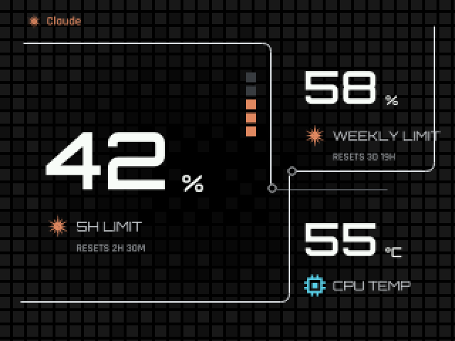
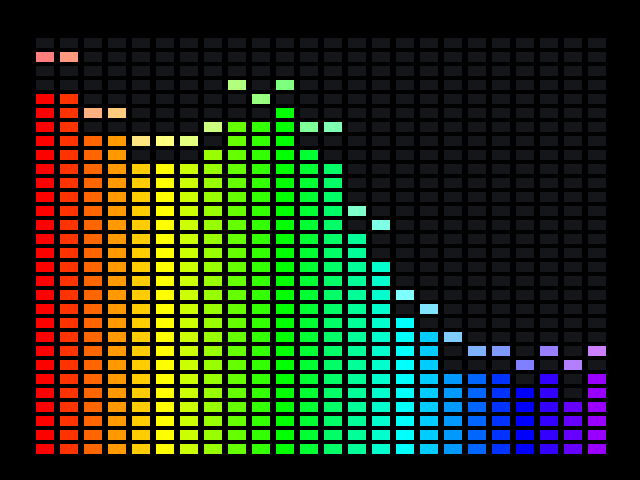
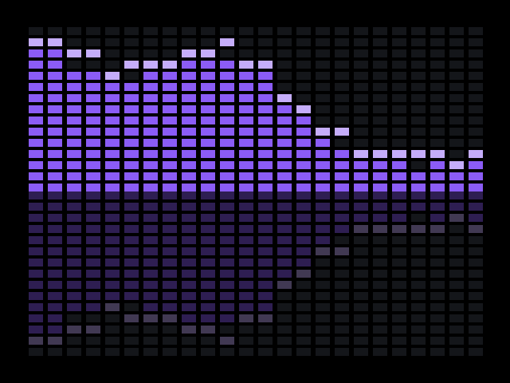
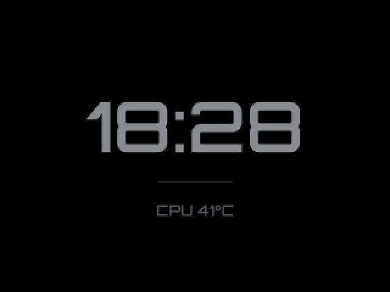
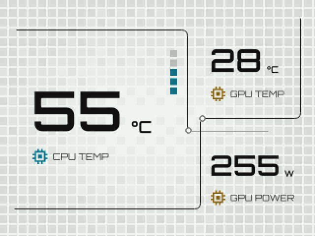
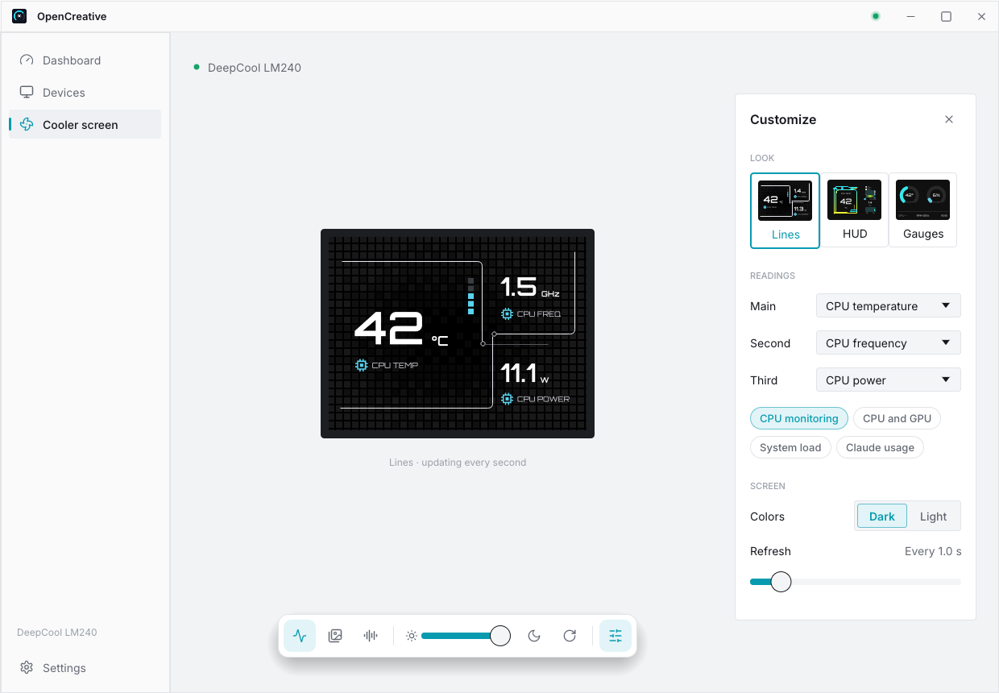
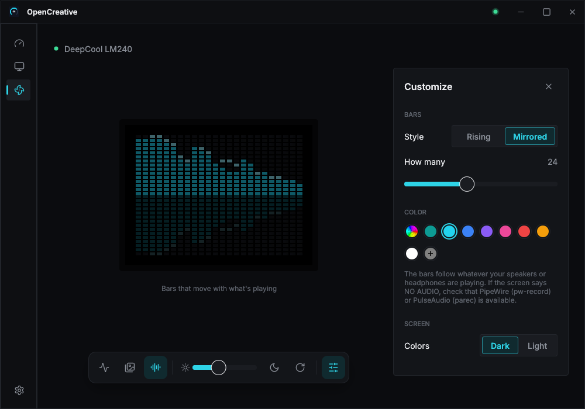

# OpenCreative

[](https://github.com/siam-parvez/opencreative/actions/workflows/ci.yml)
[](https://github.com/siam-parvez/opencreative/releases)

Control the screen on your DeepCool LCD cooler from Linux: live system
readings, images, GIFs, videos, YouTube and music bars. A free, open-source
alternative to DeepCool's Windows-only DeepCreative app, with displays from
other brands (NZXT, Lian Li, ASUS and more) on the way.

> OpenCreative is an independent project. It is not affiliated with or endorsed
> by DeepCool. "DeepCool" and "DeepCreative" are trademarks of their owners.

<p>
  
</p>

## Install

Download the file for your system from the
[latest release](https://github.com/siam-parvez/opencreative/releases/latest)
and open it in your software center, or:

```sh
sudo apt install ./opencreative_*_amd64.deb     # Ubuntu, Debian, Mint, Pop!_OS
sudo dnf install ./opencreative-*.x86_64.rpm    # Fedora, openSUSE
```

Anything else: the `.AppImage` (make it executable, then open it). ARM: the
`arm64` / `aarch64` files.

Open **OpenCreative** from your app menu. The cooler is found automatically
and its screen keeps running in the background, after restarts too. To
update, install the new file the same way.

## On the cooler

<table>
  <tr>
    <td align="center"><br><b>Lines</b></td>
    <td align="center"><br><b>HUD</b></td>
    <td align="center"><br><b>Gauges</b></td>
  </tr>
  <tr>
    <td align="center"><br><b>Claude usage</b></td>
    <td align="center"><br><b>Music, rainbow</b></td>
    <td align="center"><br><b>Music, mirrored</b></td>
  </tr>
  <tr>
    <td align="center"><br><b>Zen clock</b></td>
    <td align="center"><br><b>Light screens</b></td>
    <td align="center"><b>Your pictures, GIFs,<br>videos and YouTube</b><br>playlists, or one color</td>
  </tr>
</table>

## In the app

<p>
  
  
</p>
<p>
  
  
</p>

A top-bar menu switches modes, looks, brightness, colors and rotation
without opening the window.

**Optional:** YouTube downloads its helper (yt-dlp) the first time you add a
link. CPU power readings are off by default
([why](https://nvd.nist.gov/vuln/detail/CVE-2020-8694)); turn them on in
**Settings**. [Claude Code](https://claude.com/claude-code) users can show
their usage limits (**Settings → Integrations**; not affiliated with
Anthropic).

## Supported coolers

| Cooler | USB ID | Screen |
|---|---|---|
| DeepCool LM240 / LM360 | `3633:0026` | 320 × 240 |

Displays from NZXT, Lian Li, ASUS and other brands are planned. Have another
one? [Request support](https://github.com/siam-parvez/opencreative/issues/new?template=new-device.yml)
or see [adding a device](docs/adding-a-device.md).

## Help

- **No cooler found**: replug its USB cable, or use **Settings → Allow access to the cooler**.
- **Music bars say NO AUDIO**: check that sound plays through PipeWire or PulseAudio.
- **Anything else**: [open an issue](https://github.com/siam-parvez/opencreative/issues).

**Uninstall:** remove OpenCreative in your software center
(`sudo apt remove opencreative`), or for the AppImage use **Settings → Uninstall**.

<details>
<summary><b>Command line</b></summary>

Everything except the music bars is also available as `opencreative`
commands. While the background service runs, commands go to it and are
remembered.

```sh
opencreative list                      # find connected coolers
opencreative panels                    # live readings in panels (the default screen)
opencreative panels --primary gpu-temp --secondary gpu-load --secondary ram-usage
opencreative panels --skin hud         # neon skin with live charts
opencreative monitor                   # live readings as gauges
opencreative media wallpaper.gif       # images, GIFs, videos
opencreative media a.png b.gif clip.mp4 --seconds 15   # a playlist
opencreative media cat.jpg --zoom 2 --focus 0.3,0.4    # zoom in on a point
opencreative media "https://www.youtube.com/watch?v=…"
opencreative solid '#ff8800'
opencreative brightness 60
opencreative zen on                    # calm clock; `zen off` returns
opencreative screen off                # backlight off; `screen on` restores it
opencreative --rotate 180 monitor      # upside-down pump
opencreative sensors                   # which sensors were found
opencreative preview monitor -o out.png   # render to a PNG, no cooler needed
opencreative status                    # what the background service is showing
```

Settings live in `~/.config/opencreative/config.toml`, for example:

```toml
rotation = 0
brightness = 60

[scene]
type = "music"          # or "panels", "monitor", "media", "solid"
style = "mirror"        # "bars" or "mirror"
color = "#22d3ee"
rainbow = false
bars = 24
```

</details>

<details>
<summary><b>Build from source</b></summary>

You need Rust and a C toolchain:

```sh
sudo apt install build-essential          # Debian/Ubuntu
curl https://sh.rustup.rs -sSf | sh       # if Rust isn't installed
cargo install --path crates/opencreative-cli
cargo install --path crates/opencreative-gui
opencreative-gui
```

Then, in the app's **Settings**, turn on **Allow access to the cooler**,
**Show in the app menu** and **Start with the computer**.

The workspace:

```
crates/
  opencreative-protocol   packet encoding (no I/O), tested against captures
  opencreative-device     USB discovery and transport, a `Display` per model
  opencreative-sensors    system readings
  opencreative-audio      what's playing, as a spectrum (music bars)
  opencreative-render     drawing: skins, images, GIFs, videos, music bars
  opencreative-core       scene playback, reconnecting, the daemon engine
  opencreative-config     TOML settings
  opencreative-ipc        JSON-lines protocol between the daemon and its clients
  opencreative-daemon     the background service
  opencreative-cli        the `opencreative` command
  opencreative-gui        the desktop app (egui)
```

New coolers implement `Display` in `opencreative-device`; nothing else changes.

</details>

## Roadmap

- [x] Desktop app, background service, Linux packages
- [x] Images, GIFs, videos, YouTube and music bars
- [ ] Displays from other brands: NZXT, Lian Li, ASUS and more
- [ ] More DeepCool coolers: Mystique, LQ, LP, AK/LS/LD digital series
- [ ] RGB lighting, written from scratch in Rust: motherboard, RAM, mic and
      case fans, synced to music
- [ ] Custom screen layouts, fonts and backgrounds
- [ ] Windows and macOS (maybe, later)

## Credits

- Icons: [Lucide](https://lucide.dev) (ISC, `assets/icons/LICENSE-lucide.txt`).
- Device pictures in `assets/devices/` are DeepCool's product images, used to
  identify the hardware; they remain DeepCool's property.
- Protocol captures: [daedlock/deepcool-lm](https://github.com/daedlock/deepcool-lm) (MIT)
- Fonts (SIL OFL 1.1): [Rajdhani](https://fonts.google.com/specimen/Rajdhani) by Indian Type Foundry and [Orbitron](https://github.com/theleagueof/orbitron) by The League of Moveable Type on the cooler screen; [Inter](https://github.com/rsms/inter), [Geist](https://github.com/vercel/geist-font), [Manrope](https://github.com/googlefonts/manrope) and [IBM Plex Sans](https://github.com/IBM/plex) in the app.

## License

Dual-licensed under [MIT](LICENSE-MIT) or [Apache-2.0](LICENSE-APACHE), at your option.
Bundled fonts are under the SIL Open Font License: [Rajdhani](assets/fonts/OFL-Rajdhani.txt) and [Orbitron](assets/fonts/OFL-Orbitron.txt) (screen); [Inter](assets/fonts/OFL-Inter.txt), [Geist](assets/fonts/OFL-Geist.txt), [Manrope](assets/fonts/OFL-Manrope.txt) and [IBM Plex Sans](assets/fonts/OFL-IBMPlexSans.txt) (app).
